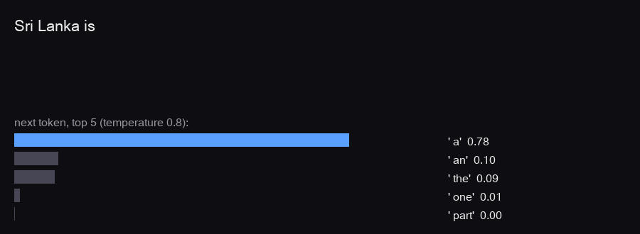
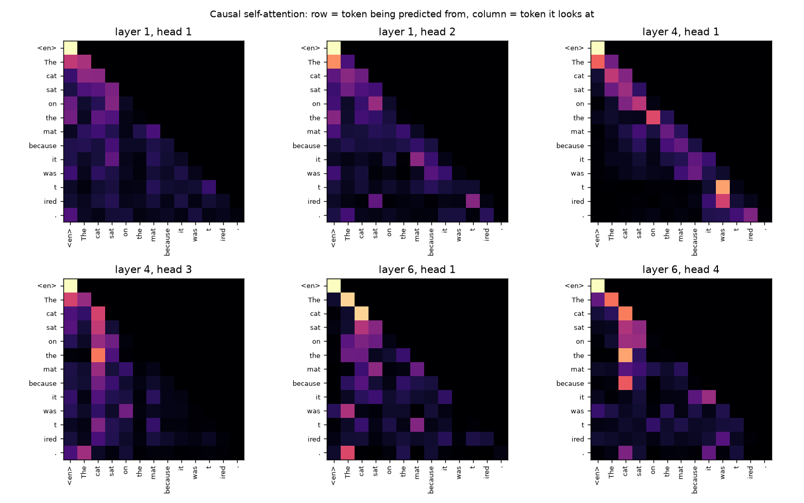
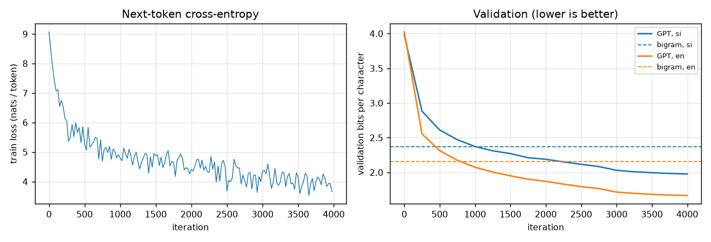

# Tiny GPT for Sinhala + English, from scratch

A small decoder-only Transformer (the architecture behind ChatGPT), written out in full in PyTorch and
trained on **Sinhala and Simple-English Wikipedia** on an 8 GB M1 MacBook Air. It includes a BPE tokenizer
trained on the same text, plus a fix for a tokenizer problem that hits Sinhala (and other Indic scripts)
in the standard GPT-2 recipe.



## Results

Validation text comes from Wikipedia articles held out of training (2% of articles in each language).
Bits per character (bpc) is used so that the two languages can be compared fairly, even though they
split into different numbers of tokens per character. Lower is better.

| model | Sinhala bpc | English bpc |
|---|---|---|
| unigram (token frequencies only) | 3.52 | 3.35 |
| bigram (previous token only, smoothed) | 2.37 | 2.16 |
| **this GPT, 13.9M parameters, 4000 steps** | **1.98** | **1.67** |

The Transformer beats the bigram baseline by 0.39 bpc in Sinhala and 0.49 in English: it uses up
to 256 tokens of context instead of 1. Sinhala stays harder for the same model, partly because Sinhala
Wikipedia is smaller and noisier, and partly because the script has more distinct characters.

Samples at temperature 0.7 (unedited; full set in `results/samples.json`):

> **ශ්‍රී ලංකාවේ** 1978 ආණ්ඩුක්‍රම ව්‍යවස්ථාව විසින් පාර්ලිමේන්තු මන්ත්‍රීවරුන් තෝරා පත්කර ගැනුම සඳහා සමානුපාතික නියෝජන මැතිවරණ කොට්ඨාශයක් ලෙස හඳුන්වාදෙන ලදී.

*Roughly: "(It) was introduced by Sri Lanka's 1978 constitution as a proportional-representation
electoral district for electing members of parliament."* Its phrases ("1978 constitution",
"proportional representation", "electing members") each appear in 150+ training articles, but the
full sentence appears in none of them (checked by exact search), so the model composed it.

> **Sri Lanka is** a World Series branch of the 2006 World Woman Empire in 2015. Crasan also is played
> by the former coalition of the Premier League in the U.S.

Fluent, Wikipedia-shaped and completely made up, which is what a 14M-parameter model trained for an
hour should produce.

## A tokenizer bug that hits Sinhala

GPT-2's tokenizer first splits text into "words" with a regex whose letter class is `\p{L}`. Sinhala vowel
signs (*pili* such as ා ි ු ේ) and the virama (්) are Unicode **marks** (`\p{M}`), not letters, so that
regex **cuts every Sinhala word at every vowel sign** before BPE ever sees it:

```
GPT-2 split:  ප | ි | හ | ි | ට | ි      ("පිහිටි" = located)
fixed split:  පිහිටි
```

The fix is one line: count `\p{M}` and the zero-width joiner (used in ශ්‍රී) as part of a word. Same data,
same 8,192-token vocabulary:

| | GPT-2-style pre-tokenizer | fixed pre-tokenizer |
|---|---|---|
| Sinhala training tokens | 29.6M | **13.6M** |
| characters per Sinhala token | 1.52 | **3.30** |
| tokens for the sample sentence below | 54 | **22** (OpenAI's GPT-2 tokenizer: 220) |
| bigram baseline, Sinhala (bits/char) | 3.40 | **2.37** |

Sample sentence: *ශ්‍රී ලංකාව ඉන්දියන් සාගරයේ පිහිටි දිවයිනකි. එහි අගනුවර ශ්‍රී ජයවර්ධනපුර කෝට්ටේ වේ.*
With the fix it splits as `ශ්‍රී | ලංකාව | ඉන්ද | ියන් | සාගර | යේ | පිහිටි | ...`.

Sinhala text now costs about the same number of tokens as English text of the same length, so the
model's 256-token context covers about 2× more Sinhala, and every training step sees 2× more of it.

## How it works, in plain words

1. **Tokenize.** Text becomes a sequence of integer token ids (pieces of words).
2. **Embed.** Each id becomes a 384-number vector, and a second vector encodes its position.
3. **Attend.** In each of the 6 layers, every token looks back at the earlier tokens and decides which
   ones matter for it (self-attention), then passes the mix through a small MLP. A causal mask stops it
   from looking at the future.
4. **Predict.** The last layer gives a probability for each of the 8,192 possible next tokens. Training
   just maximises the probability of the token that actually came next.
5. **Generate.** Sample a token, append it, repeat.



## The core equations

Scaled dot-product attention with a causal mask $M$ ($M_{ij} = -\infty$ for $j > i$):

```math
\text{Attention}(Q, K, V) = \text{softmax}\!\left(\frac{QK^\top}{\sqrt{d_k}} + M\right)V
```

One Transformer block (pre-LayerNorm):

```math
h = x + \text{MHA}(\text{LN}(x)), \qquad y = h + \text{MLP}(\text{LN}(h))
```

Training objective, next-token cross-entropy:

```math
\mathcal L = -\frac{1}{T}\sum_{t=1}^{T} \log p_\theta(x_t \mid x_{\lt t})
```

Bits per character, used to compare the two languages fairly (they have different tokens per character):

```math
\text{bpc} = \frac{\mathcal L}{\ln 2} \cdot \frac{\#\text{tokens}}{\#\text{characters}}
```

## Training



| setting | value |
|---|---|
| data | si Wikipedia (all usable articles, 45M chars) + the same number of characters of Simple-English Wikipedia; 2% of *articles* held out for validation |
| tokenizer | byte-level BPE, 8,192 tokens, trained on the training split only |
| model | 6 layers, 6 heads, d = 384, context 256, tied embeddings, 13.9M parameters |
| optimiser | AdamW (β = 0.9, 0.95), lr 6e-4, warmup 200, cosine decay, weight decay 0.1, batch 32 × 256 tokens (16 × 2 gradient accumulation to fit in 8 GB), 4000 steps ≈ 33M tokens ≈ 1.2 passes over the data |
| hardware | M1 MacBook Air 8 GB (PyTorch MPS), about 1 s per step when the machine is otherwise idle (about 70 min in total); the actual run took about 3 h because memory pressure pushed it into swap. The run started on a 6000-step cosine schedule and was resumed at step 2750 on a 4000-step schedule to finish sooner, which is the small kink in the validation curve |

## Reproduce

```bash
git clone https://github.com/Nipuna-Lakruwan/tiny-gpt-sinhala
cd tiny-gpt-sinhala
uv sync
uv run python src/prepare.py      # downloads ~210 MB of Wikipedia parquet, trains the tokenizer
uv run python src/baselines.py    # unigram/bigram baselines + tokenizer comparison
uv run python src/train.py        # ~70 min on an idle M1 Air (add --bs 16 --accum 2 on 8 GB); resumes from checkpoints/last.pt
uv run python src/figures.py
uv run pytest
```

## Limits

This is a 13.9M-parameter model trained for about one pass over 28M tokens: it learns spelling, grammar and
Wikipedia style, but its "facts" are often invented. Sinhala Wikipedia is small and has a lot of
template-like articles (villages, years), and that shows in the samples. Data: Wikipedia, CC BY-SA 4.0.

## Resume line

> Built a GPT-style decoder-only Transformer (13.9M parameters) and a byte-level BPE tokenizer from scratch in PyTorch, trained on Sinhala + English Wikipedia on an 8 GB M1 laptop; found and fixed a GPT-2 pre-tokenizer bug that splits Sinhala words at every vowel sign (2.2× fewer Sinhala tokens), and reached 1.98 / 1.67 bits per character on held-out Sinhala / English text, against 2.37 / 2.16 for a bigram baseline.

## References

- Vaswani et al., *Attention Is All You Need*, 2017.
- Radford et al., *Language Models are Unsupervised Multitask Learners* (GPT-2), 2019.
- Karpathy, *nanoGPT*, used as a reference for the training-loop conventions.
- Sennrich et al., *Neural Machine Translation of Rare Words with Subword Units* (BPE), 2016.

MIT License.
